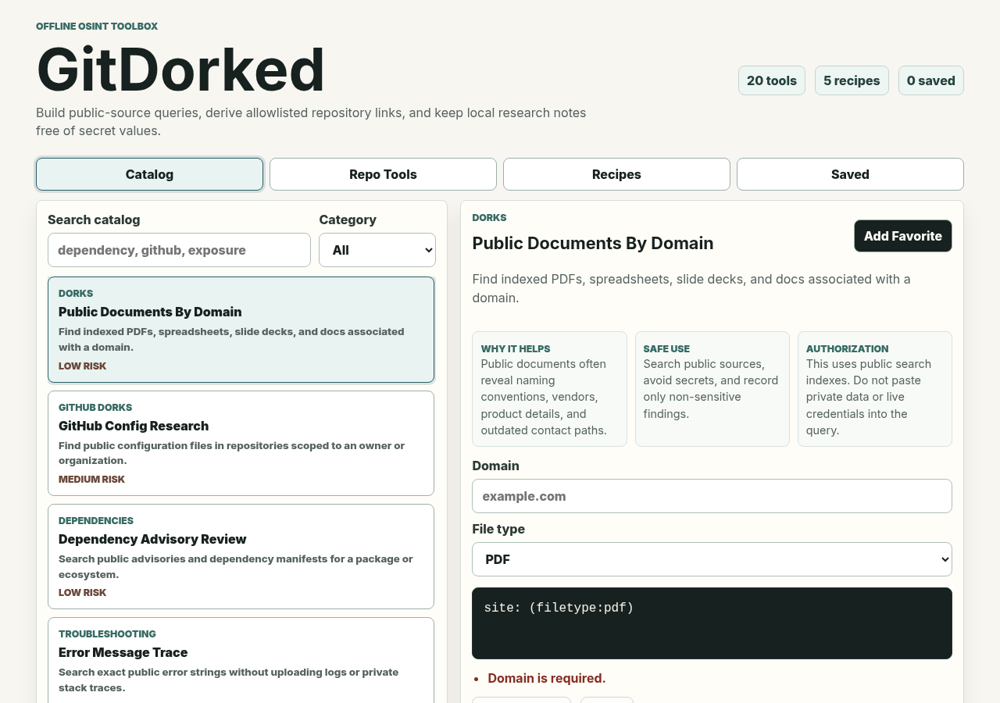

# GitDorked

**Dork GitHub like a pro — curated OSINT queries, allowlisted repo transforms, and recon recipes in one fast, mobile-friendly web app. No install, no API key.**

🔗 **Live demo:** https://gitdorked.onrender.com



GitDorked is a mobile-friendly repository research and public-source query launcher. It combines curated Google/GitHub research queries, verified repository URL transforms, repeatable recipes, favorites, and local history in one TypeScript/React app — with defensive secret redaction baked in so your inputs and outputs stay clean.

> **Authorized / ethical use only.** GitDorked includes exposed-secret search queries meant for public-source research and for assets you own or are explicitly authorized to assess. It is not a credential-validation, exploitation, login-automation, or bulk-scanning tool. Use it responsibly and within scope.

## Features

- Searchable catalog with category filtering and query/template variables.
- Copy and launch actions for Google and GitHub searches.
- Repository URL parser that accepts canonical GitHub HTTPS repository URLs only.
- GitHub-native repository actions for code, releases, dependencies, CI, security, and navigation.
- Verified repo transforms for github.dev, GitDiagram, GitIngest, and DeepWiki.
- Native/external service labels plus purpose, login/cost notes, risk, and authorization guidance.
- Favorites, recent generated outputs, and recent repository history stored locally when browser storage is available.
- Recipes for repository baselining, documentation review, dependency remediation, exposure triage, and release readiness.
- Defensive secret/token redaction before display, copy, or launch.
- Responsive desktop/mobile interface.

## Local Setup

Requirements: Node.js 20+ and npm.

```bash
npm install
npm run dev
```

Vite prints the local development URL. No API key is required for the core app.

## Build and Test

```bash
npm test
npm run build
```

The production build is emitted to `dist/` and is ignored by Git.

## Safe-Use Scope

GitDorked is for public-source research and repositories, domains, or organizations you own or are explicitly authorized to assess. Defensive exposure-review entries are intentionally path/type oriented: they are not credential validation, login automation, exploitation, or bulk scanning tools.

Never paste live credentials, private keys, session cookies, or private operational data into search fields. The app rejects credential-bearing GitHub URLs and redacts common token/secret patterns from generated text, but redaction is a guardrail rather than a substitute for keeping secrets out of inputs.

External repo services receive the public repository identity in their generated URL. Use private-repository features only through the external provider's documented authorized flow; GitDorked never puts a private access token into a generated repo URL.

## Architecture

```text
src/
  App.tsx                  React application and interaction handlers
  styles.css               Responsive application styles
  core/
    domain.ts              Shared typed contracts
    github.ts              GitHub parser and allowlisted repo transforms
    interpolation.ts         Template validation/interpolation and launch URLs
    safety.ts                Secret detection/redaction helpers
    search.ts                Catalog filtering
    seeds.ts                 Curated catalog and recipe data
    storage.ts               Local persistence abstraction
  test/setup.ts              Vitest DOM setup
```

The UI consumes declarative tool/recipe definitions from `src/core`. Repository launch URLs are generated only from allowlisted templates and hostnames.

## Adding a Catalog Tool

Add a `ToolEntry` to `sampleTools` in `src/core/seeds.ts`.

1. Give the tool and template unique IDs.
2. Add a clear description, why-useful note, usage guidance, category, tags, risk, and authorization scope.
3. Declare every `{{variable}}` in the template's `variables` array.
4. Use only approved launch hosts supported by `buildLaunchUrl`.
5. Keep defensive entries focused on owned/authorized assets and never include credential-harvesting or validation workflows.
6. Add or update tests for template validity and seed integrity.

## Adding a Repository Transform

Add a typed `GitHubTool` entry in `src/core/github.ts`.

Each repo tool must define its source type, provider, description, why-useful note, login/cost status, risk, authorization guidance, and either a GitHub path template or verified HTTPS URL template.

For an external transform:

1. Verify the real owner/repo URL format before adding it.
2. Add the hostname to `repositoryToolHostnames`; do not use redirects or guessed endpoints.
3. Never interpolate usernames, passwords, tokens, or arbitrary hosts.
4. Add an exact URL-generation test in `src/core/github.test.ts`.
5. Confirm the generic Copy URL/Open controls operate through the shared repository card.

Current verified transform patterns:

- `https://github.dev/{owner}/{repo}`
- `https://gitdiagram.com/{owner}/{repo}`
- `https://gitingest.com/{owner}/{repo}`
- `https://deepwiki.com/{owner}/{repo}`

## Persistence

Favorites, recent generated outputs, and recent repository URLs use browser local storage under `gitdorked:v1`. The storage adapter falls back safely when browser storage is unavailable or malformed.

## Support

If GitDorked saves you time, you can support development:

[](https://buymeacoffee.com/anthonyleebuilds)

## License

Released under the [MIT License](LICENSE).

## Suggested GitHub Topics

`osint` · `github-dorks` · `security` · `recon` · `bug-bounty` · `react` · `vite` · `typescript` · `appsec` · `security-tools`
